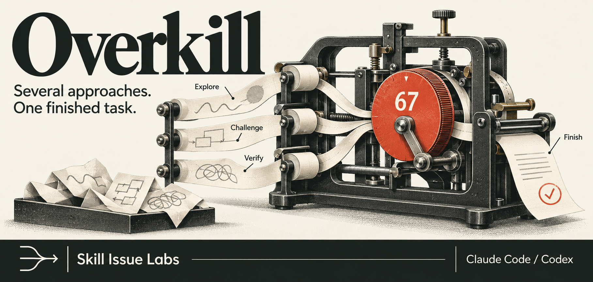
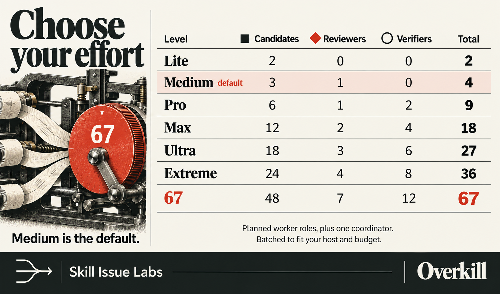

# Overkill

An agent skill from **Skill Issue Labs** that compares approaches, checks the evidence that decides between them, and finishes the chosen solution.

Use it in Claude Code or Codex when a repair, redesign, architecture decision or research plan has more than one credible approach. Pick an effort level from two to sixty-seven planned worker roles. **Medium is the default.**

## Install

Clone this repository, or download and extract its source archive. The installer requires Python 3.10 or newer.

```sh
git clone https://github.com/pizziyicato/overkill.git
cd overkill
```

From the repository root, choose your host.

```sh
# Choose your host
python3 scripts/install.py --target claude
python3 scripts/install.py --target codex

# Or install for both
python3 scripts/install.py --target both
```

The installer copies files locally. It uses the Python standard library and makes no network calls. An existing, different installation is preserved unless you explicitly replace it.

Open a fresh session and check that Overkill appears in the skill list. Then ask for the work you want done.

**Claude Code**

```text
/overkill Pro Fix duplicate imports in this pipeline. Compare a minimal repair,
a component replacement and a redesign. Preserve the file format.
Implement the best feasible option and test repeated imports.
```

**Codex**

```text
$overkill Pro Fix duplicate imports in this pipeline. Compare a minimal repair,
a component replacement and a redesign. Preserve the file format.
Implement the best feasible option and test repeated imports.
```

See the [installation guide](docs/installation.md) for project installs, updates, aliases, manual installation and other hosts. Local file installation has been tested. Client discovery and invocation have not yet been verified.

## How it works

1. Establish a shared brief with the facts, constraints and acceptance criteria.
2. Develop approaches that differ in substance and discard those that cannot meet the brief.
3. Check the claims and failure cases that could change the choice.
4. Complete the selected approach and verify the result against the original request.

For advice, it delivers a recommendation. For an implementation request, it is instructed to finish the work. A combined design gets its own checks. If every option fails a hard constraint, Overkill says so.

The [skill](skills/overkill/SKILL.md) is a set of instructions. The installed folder has no scripts, hooks, connectors or runtime package dependencies. It uses the tools and permissions your agent already has.

## Choose the effort



| Level | Candidates | Reviewers | Verifiers | Total workers |
| --- | ---: | ---: | ---: | ---: |
| **Lite** | 2 | 0 | 0 | **2** |
| **Medium** | 3 | 1 | 0 | **4** |
| **Pro** | 6 | 1 | 2 | **9** |
| **Max** | 12 | 2 | 4 | **18** |
| **Ultra** | 18 | 3 | 6 | **27** |
| **Extreme** | 24 | 4 | 8 | **36** |
| **67** | 48 | 7 | 12 | **67** |

The coordinator is additional to these counts and checks the final result at every level. Candidates propose approaches, reviewers compare them, and verifiers test decisive claims and failure cases. Lite and Medium leave verification with the coordinator. See the [effort profiles](skills/overkill/references/effort-levels.md) for role assignments and correction limits.

These are planned roles across the whole run, not simultaneous agents. A concurrency limit leads to batches. Without delegation tools, the skill uses explicitly labelled **same-context alternatives**. Your time, usage and tool limits take priority, and the agent must report material changes to the plan and what actually ran.

Level names are request text, not CLI flags or model settings. A number 67 in task data does not select the 67 tier. Simple tasks should stay simple, even when a high tier is requested.

```text
$overkill Lite Compare these two proposals using only the supplied figures.
Recommend one in 200 words.
```

```text
$overkill 67 Evaluate this migration across distinct strategy families.
Plan 48 candidates, 7 reviewers and 12 verifiers within the available worker slots.
Keep candidate work isolated. Deliver an implementation plan within two hours.
```

The [worked examples](examples/README.md) show feasibility checks, a misleading claim and a task that needs no panel.

## What has been tested

The repository includes [behavioral cases](evals/README.md), structural checks and isolated installer tests. The [recorded smoke tests](evals/RESULTS.md) describe the observed answers and their limits. Scheduling cases checked plans, not live execution of the larger worker allocations. They do not establish better accuracy, lower cost or faster completion than a baseline.

More agents can share the same blind spots. More comparison can cost more time and tokens. Overkill cannot enable missing tools or enforce a runtime budget by itself, and higher effort does not guarantee a better result.

## Contribute

Bring a concrete failure case and a small improvement. [CONTRIBUTING.md](CONTRIBUTING.md) covers local checks and behavioral evaluation. The [CI workflow](.github/workflows/validate.yml) checks the package and installer without model calls or an API key. See the current results in [GitHub Actions](https://github.com/pizziyicato/overkill/actions/workflows/validate.yml).

## Credit and license

Overkill is an independent adaptation of [Jake Schincariol's 67](https://github.com/Jakeschincariol/claude-illegal-codes/tree/main/67), originally published in `claude-illegal-codes`. It adds effort profiles, feasibility checks, targeted verification and checks of the completed result.

Released under the [MIT license](LICENSE), with the original copyright notice preserved. Documentation artwork is described in [assets/README.md](assets/README.md).
